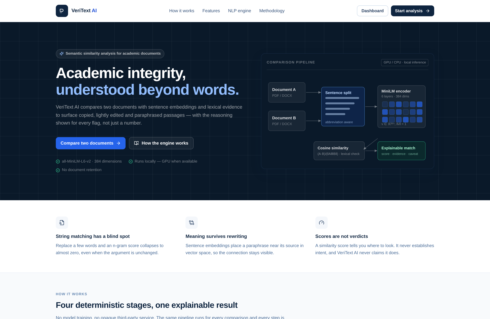
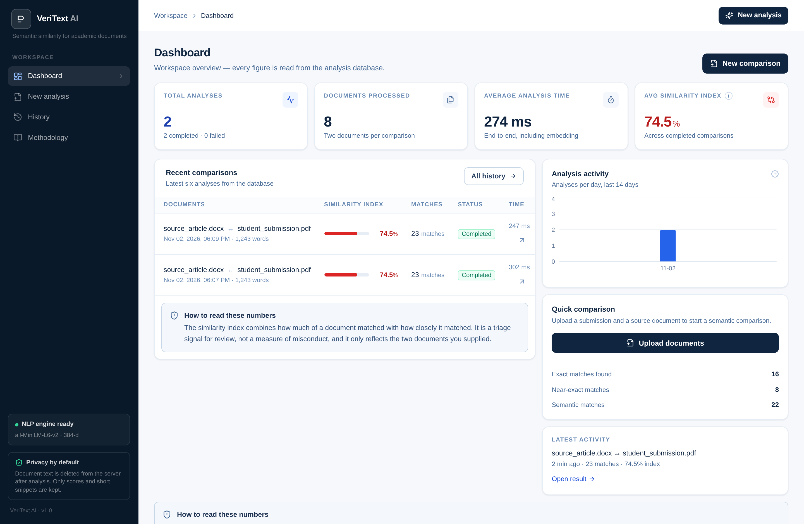
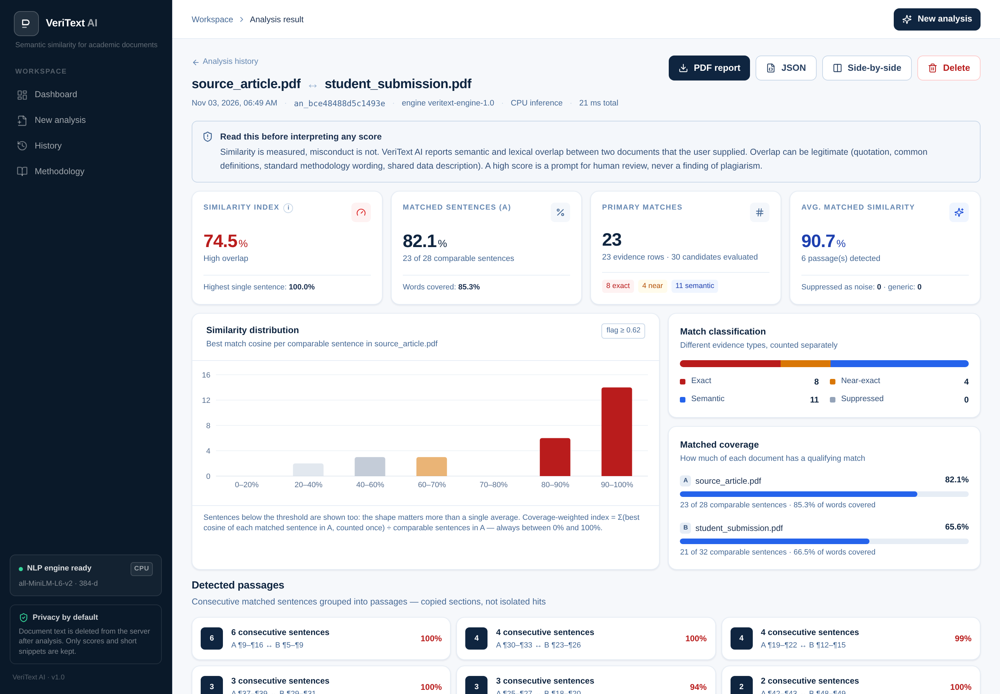
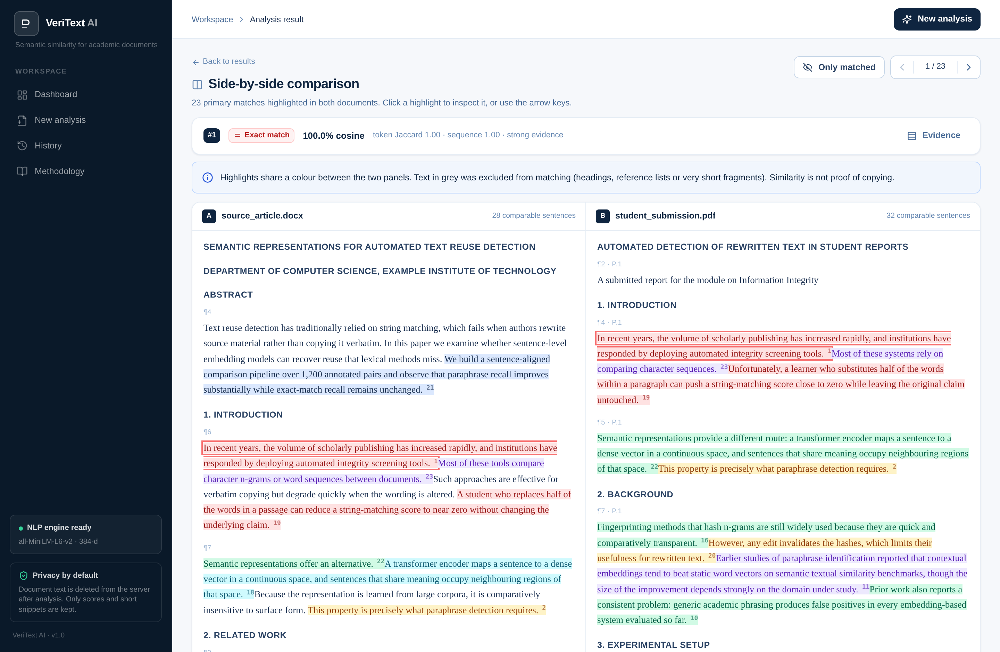
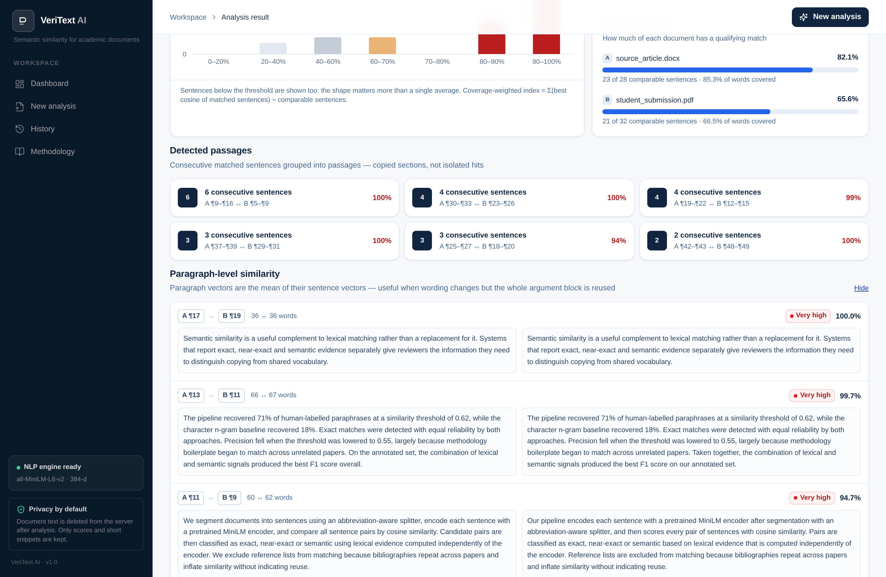
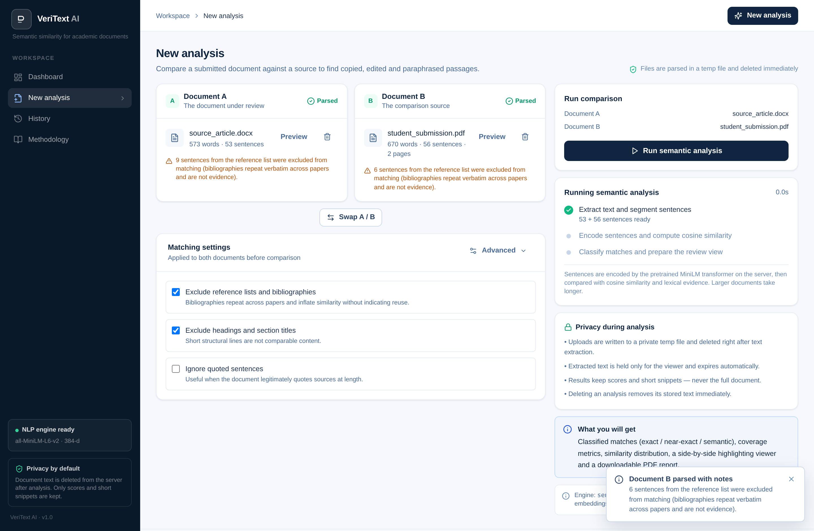
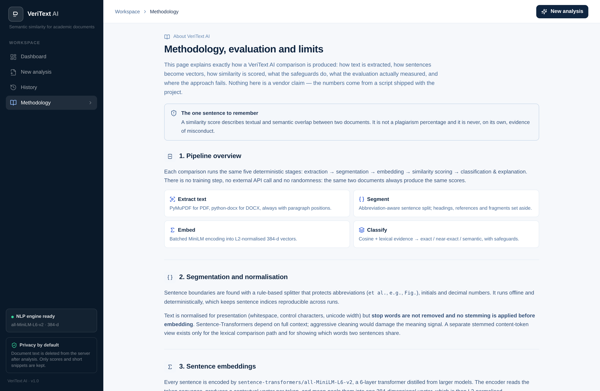
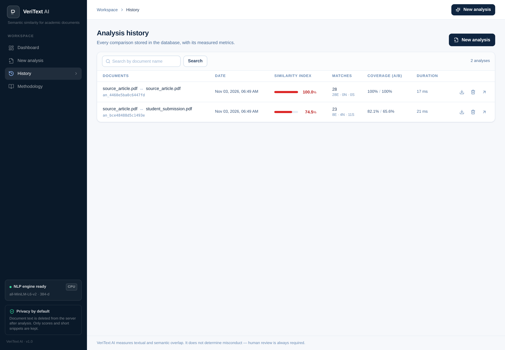
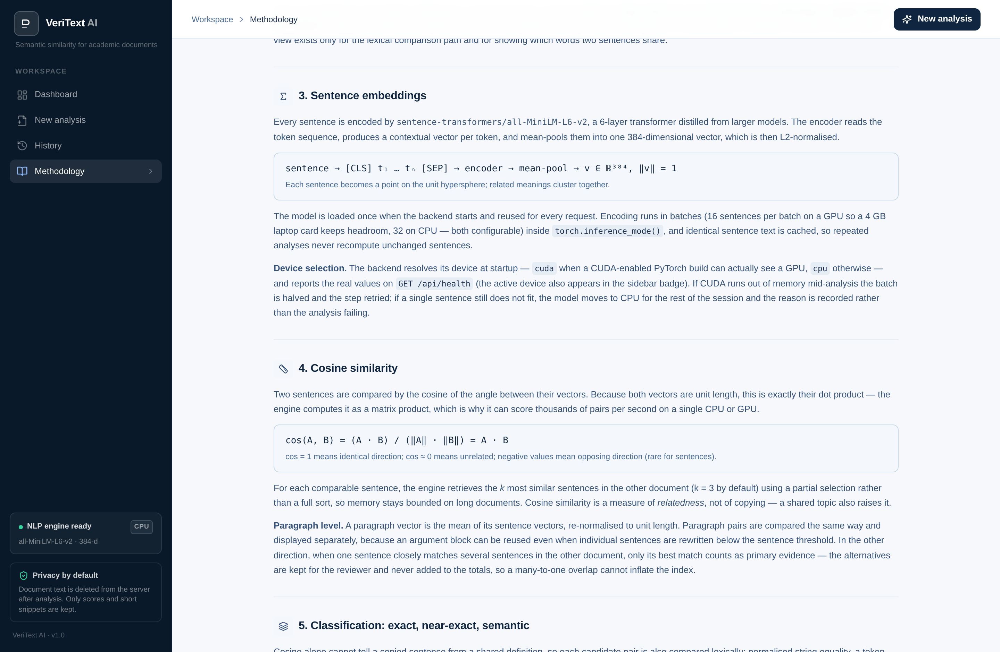

# VeriText AI

**Advanced Academic Plagiarism Detection Using Sentence Embeddings**
*Beyond Matching Words. Understanding Meaning.*

VeriText AI compares two academic documents and reports copied, lightly edited and **paraphrased**
passages using pretrained sentence embeddings, cosine similarity and independent lexical evidence.
Every flag is explainable — score, evidence type, shared terms, verbatim run and an explicit caveat —
and the application never presents a similarity score as a plagiarism verdict.

---

## Table of contents

1. [Problem statement](#1-problem-statement)
2. [Objectives](#2-objectives)
3. [Features](#3-features)
4. [Technology stack](#4-technology-stack)
5. [System architecture](#5-system-architecture)
6. [Project structure](#6-project-structure)
7. [Environment, hardware and device selection](#7-environment-hardware-and-device-selection)
8. [Installation (Windows, Conda, CUDA)](#8-installation-windows-conda-cuda)
9. [How to run](#9-how-to-run)
10. [NLP methodology](#10-nlp-methodology)
11. [Evaluation results (measured)](#11-evaluation-results-measured)
12. [API documentation](#12-api-documentation)
13. [Testing](#13-testing)
14. [Screenshots](#14-screenshots)
15. [Privacy and security](#15-privacy-and-security)
16. [Limitations](#16-limitations)
17. [Future enhancements](#17-future-enhancements)
18. [Viva / presentation material](#18-viva--presentation-material)

---

## 1. Problem statement

Institutions screen academic work for text reuse. The dominant technique — character n-gram or
substring matching — is fast and easy to explain, but it fails precisely where honesty matters most:

* replacing half the words in a paragraph drops a string-matching score to almost zero while the
  claim, structure and reasoning stay identical;
* reordering clauses, swapping synonyms or changing voice is enough to defeat fingerprinting;
* at the same time, every screening tool drowns reviewers in false positives from bibliographies,
  standard methodology sentences and textbook definitions.

The problem is therefore twofold: **detect reuse that survives rewriting**, and **avoid accusing
writers of misconduct for language they did not uniquely choose**.

## 2. Objectives

1. Extract text from PDF and DOCX reliably, preserving paragraph positions for later highlighting.
2. Segment documents into sentences deterministically, keeping headings, fragments and reference
   lists out of the comparison.
3. Encode every sentence with the pretrained transformer `sentence-transformers/all-MiniLM-L6-v2`
   and compute real cosine similarity between both documents — no hardcoded scores, no simulation.
4. Distinguish **exact**, **near-exact** and **semantic (paraphrase)** overlap, because they are
   different kinds of evidence.
5. Group matches into passages, measure coverage, and expose every match with a human-readable
   explanation rather than a single percentage.
6. Apply safeguards against bibliographies, generic academic phrasing, citation-only overlap and
   definition-shaped pairs.
7. Store analysis history, generate downloadable PDF reports, and delete document text on a
   short time-to-live so confidential work is not retained indefinitely.
8. Evaluate the engine honestly on a labelled dataset and publish the numbers, including the
   failures.

## 3. Features

**Analysis**
- Two-document comparison (Document A ↔ Document B) with PDF, DOCX and plain-text support.
- Sentence- and paragraph-level similarity; top-k candidate retrieval instead of an unmanageable
  all-pairs matrix.
- Classification into exact / near-exact / semantic, with a paraphrase sub-signal.
- Passage clustering: consecutive matches are grouped so a reviewer sees "6 consecutive sentences",
  not six unrelated rows.
- Coverage metrics: sentence coverage, word coverage, average matched similarity, and a
  coverage-weighted similarity index whose formula is stated in the UI and the report.
- Many-to-one handling: one sentence matching several others counts once as primary evidence; the
  alternatives remain visible without inflating totals.

**Explainability**
- Per match: cosine score, token Jaccard, token-sequence ratio, shared distinctive terms (surface
  forms, not stems), longest verbatim run, document position (paragraph, sentence, page).
- A written rationale per match and a caveat stating that overlap is not misconduct.
- Processing notes listing every exclusion (reference lists, short fragments, quoted text).

**Review workflow**
- Side-by-side viewer with colour-linked highlights, match navigation and keyboard shortcuts.
- Filter/search/sort on the results page; alternative-match toggle; suppressed-match view.
- Analysis history with search, pagination and deletion.
- Downloadable PDF report (methodology, evidence, limitations, disclaimer) and raw JSON export.

**Privacy**
- Uploads are written to a private temp file, parsed, then deleted immediately.
- Extracted text lives only in a TTL session store (default 120 minutes) and is purged on delete.
- The database stores metrics and short snippets — not full documents.

## 4. Technology stack

| Layer | Technology |
|---|---|
| Frontend | React 18, Vite, Tailwind CSS, React Router, Axios, Lucide icons, Recharts |
| Backend | Python 3.11–3.13, Flask 3, Flask-CORS, REST/JSON |
| NLP | sentence-transformers, PyTorch (CUDA-enabled build with automatic CPU fallback), Hugging Face `all-MiniLM-L6-v2`, scikit-learn, NumPy, Pandas |
| Extraction | PyMuPDF (PDF), python-docx (DOCX), regular expressions |
| Storage | SQLite (analyses, matches, document metadata) + TTL session store for extracted text |
| Reports | ReportLab (Platypus) |
| Platform | Windows 10/11 (PowerShell) reference setup, Linux/macOS also supported |
| Tests | pytest (backend), headless Chromium screenshots (UI verification) |

The model is loaded **once per process** at startup and reused for every request. It is never
trained or fine-tuned by this project. The computation device is detected at runtime
(`cuda` when a CUDA-enabled PyTorch build can see a GPU, `cpu` otherwise) and is reported by
`GET /api/health` — see [section 7](#7-environment-hardware-and-device-selection).

## 5. System architecture

```
React (Vite + Tailwind)
        │  Axios, relative /api/* URLs
        ▼
Flask REST API  ── routes/ ────────────── validation, HTTP semantics, no NLP logic
        │
        ├── services/hardware.py             Python/torch/CUDA/GPU detection, device + batch size
        ├── services/document_extractor.py   PDF/DOCX/TXT → paragraphs (+ page, offsets)
        ├── services/text_preprocessor.py    normalisation, sentence split, sections, eligibility
        ├── services/embedding_service.py    singleton MiniLM encoder on the detected device,
        │                                    batching, inference_mode, OOM retry + CPU fallback
        ├── services/similarity_engine.py    cosine matrix / top-k, lexical comparison
        ├── services/plagiarism_detector.py  classification, safeguards, clustering, metrics
        ├── services/report_generator.py     PDF report (ReportLab)
        └── services/document_store.py       TTL store for extracted text (viewer)
        │
        ▼
SQLite (models/database.py)   analyses · matches · documents
```

**Request flow for a comparison**

1. `POST /api/documents/upload` (×2) → temp file → extraction → segmentation → cached as a
   document with an expiry, preview and statistics returned to the client.
2. `POST /api/analysis/compare` → both documents are encoded in batches on the detected device, a
   top-k cosine search runs
   in both directions, each candidate pair is classified with lexical evidence, safeguards are
   applied, passages are clustered and metrics are computed.
3. The result is persisted (metadata + match snippets) and the segmented text is cached for the
   viewer. The response contains the complete explainable result.
4. `GET /api/analysis/{id}/report` regenerates the PDF from the stored result on demand; no report
   file is ever written to a public path.

**Separation of concerns**: route handlers only validate and translate; all NLP lives in `services/`
and never imports Flask.

## 6. Project structure

```
VeriText-AI/
├── backend/
│   ├── app.py                     # application factory, error handling, SPA serving
│   ├── config.py                  # every setting, env-overridable, no credentials
│   ├── check_environment.py       # python / torch / CUDA / GPU / model verification + smoke test
│   ├── requirements.txt           # runtime deps (torch installed separately, CUDA wheel)
│   ├── requirements-dev.txt       # + pytest, ruff
│   ├── .env.example               # every environment variable with its default
│   ├── routes/
│   │   ├── document_routes.py     # upload / fetch / delete cached documents
│   │   ├── analysis_routes.py     # compare, results, documents, report, export, delete
│   │   └── history_routes.py      # history, dashboard statistics
│   ├── services/
│   │   ├── document_extractor.py  # PyMuPDF + python-docx + text, scanned-PDF detection
│   │   ├── text_preprocessor.py   # cleaning, sentence splitting, sections, eligibility
│   │   ├── hardware.py            # device/CUDA/GPU detection, batch sizing
│   │   ├── embedding_service.py   # MiniLM singleton on the detected device, OOM handling
│   │   ├── similarity_engine.py   # cosine similarity, top-k, lexical evidence
│   │   ├── plagiarism_detector.py # classification, safeguards, passages, metrics
│   │   ├── report_generator.py    # PDF report
│   │   └── document_store.py      # TTL store for extracted text
│   ├── models/database.py         # SQLite schema + queries
│   ├── utils/                     # validators, JSON envelopes
│   ├── tests/                     # 80 pytest tests (engine, API, preprocessing, maths, hardware)
│   └── evaluation/
│       ├── eval_dataset.jsonl     # 59 hand-labelled sentence pairs, 7 categories
│       ├── evaluate.py            # precision / recall / F1, sweeps, error listings
│       └── make_samples.py        # builds the sample PDF/DOCX pair
├── frontend/
│   ├── src/
│   │   ├── components/            # design-system pieces (cards, badges, charts, dropzone…)
│   │   ├── layouts/AppLayout.jsx  # sidebar + top bar shell
│   │   ├── pages/                 # Landing, Dashboard, NewAnalysis, Results, Viewer,
│   │   │                          # History, Methodology, NotFound
│   │   ├── services/api.js        # Axios client + normalised errors
│   │   ├── hooks/useRequest.js
│   │   ├── utils/                 # formatting + similarity palette/labels
│   │   ├── App.jsx · main.jsx · index.css
│   │   └── package.json
│   └── index.html · vite.config.js · tailwind.config.js
├── sample_documents/              # original + submission, as .txt / .pdf / .docx
├── scripts/
│   └── setup_windows.ps1          # PowerShell setup: conda env, CUDA torch check, deps, build
├── docs/
│   ├── INSTALL_WINDOWS.md         # Windows/Conda/RTX 3050 install + troubleshooting
│   ├── evaluation_results.md      # measured evaluation (generated by the script)
│   ├── API.md                     # full endpoint reference
│   ├── VIVA_GUIDE.md              # presentation script + viva questions
│   ├── sample_report.pdf          # example generated report
│   └── screenshots/
├── storage/                       # runtime: SQLite + temp files (git-ignored)
└── README.md
```

## 7. Environment, hardware and device selection

### 7.1 Reference development environment

| Item | Value |
|---|---|
| Operating system | Windows 10 / 11 (PowerShell) |
| Python | 3.11 or 3.12 in a dedicated Conda environment (3.10+ supported) |
| GPU | NVIDIA GeForce RTX 3050 Laptop GPU, **4 GB VRAM** |
| PyTorch | CUDA-enabled wheel matching the installed driver (e.g. `cu124`, `cu121`, `cu118`) |
| Fallback | CPU inference, always available and fully supported |
| Node.js | 18+ (Vite 5 / React 18 build) |

### 7.2 Device detection

The device is resolved once at startup by `backend/services/hardware.py`:

```python
import torch
device = "cuda" if torch.cuda.is_available() else "cpu"
```

`sentence-transformers` then loads the model **onto that device**, and every encode call runs there.
There is no hard-coded `device="cpu"` anywhere, and no CPU-only wheel is required.

Resolution rules:

| `VERITEXT_DEVICE` | Behaviour |
|---|---|
| `auto` (default) | `cuda` when `torch.cuda.is_available()` is true, otherwise `cpu` |
| `cuda` | Uses the GPU; if CUDA is unavailable it degrades to CPU **and records the reason** |
| `cpu` | Never touches the GPU (useful when the GPU is busy with something else) |
| `mps` | Apple Silicon acceleration when available |

A forced device that cannot be used never fails silently: the reason is written to the startup log,
returned by `GET /api/health` (`runtime.notes`, `model.fallback_reason`) and printed by
`python check_environment.py`.

### 7.3 GPU memory management (4 GB VRAM)

- **Batching.** Embedding runs in batches: **16 sentences by default on GPU**, 32 on CPU, always
  configurable (`VERITEXT_EMBED_BATCH`, `VERITEXT_EMBED_BATCH_GPU`, `VERITEXT_EMBED_BATCH_CPU`).
- **Inference only.** Encoding happens inside `torch.inference_mode()` with gradients disabled, so no
  autograd graph is ever built, and the model is loaded exactly once per process.
- **Bounded similarity matrices.** The cosine search is evaluated in blocks of
  `VERITEXT_SIMILARITY_BLOCK_ROWS` (default 256) and immediately reduced to top-k, so the full
  sentence-by-sentence matrix (which could be 4000 × 4000 floats) is never allocated.
- **Out-of-memory handling.** On a CUDA OOM the engine empties the CUDA cache, **halves the batch and
  retries**; if a single sentence still does not fit it moves the model to CPU for the rest of the
  session (configurable with `VERITEXT_CUDA_FALLBACK_TO_CPU=false` to fail loudly instead), records
  `fallback_reason`, and the analysis still completes.
- **Honest expectations.** A 4 GB laptop GPU is not always faster than a CPU for two 600-word
  documents: transfer and kernel-launch overhead can dominate at this size. Measure with the timings
  returned by `POST /api/analysis/compare` (`engine.timings`) rather than assuming.

### 7.4 Everything the backend verifies about itself

`python check_environment.py` (run it before starting the app) checks and prints:

1. Python version (and whether it is supported),
2. PyTorch version and whether that wheel contains CUDA,
3. CUDA availability, cuDNN version, GPU name, total and free VRAM, compute capability,
4. the device the engine will actually use **and why**,
5. whether the Sentence Transformer model is in the local Hugging Face cache,
6. an end-to-end encode + cosine smoke test.

`GET /api/health` exposes the same facts as JSON (`runtime`, `model`, `limits`), so the UI and any
monitoring can see whether inference is on GPU or CPU. The sidebar badge shows `GPU` or `CPU`
accordingly.

### 7.5 Model download and first run

The weights are fetched **once** (~90 MB) into the Hugging Face cache and reused for every later run;
a comparison never downloads anything. First startup logs a clear progress line
(`Loading … on GPU (CUDA) — first run downloads ~90 MB`). If the download fails because there is no
internet connection, the backend reports `status: "model_unavailable"` with `error_kind:
"model_download_failed"`, `POST /api/analysis/compare` returns HTTP **503** `embedding_unavailable`
with an actionable message, and no scores are produced — VeriText never substitutes placeholder
numbers for a missing model. Set `VERITEXT_MODEL_LOCAL_ONLY=true` (or `HF_HUB_OFFLINE=1`) once the
model is cached to make offline operation strict.

---

## 8. Installation (Windows, Conda, CUDA)

Full step-by-step guide with troubleshooting: **[docs/INSTALL_WINDOWS.md](docs/INSTALL_WINDOWS.md)**.
The short version, in PowerShell:

### 8.1 Prerequisites

- Windows 10/11 with an up-to-date NVIDIA driver (`nvidia-smi` must list the RTX 3050)
- Miniconda or Anaconda
- Node.js 18+ and npm
- ~5 GB free disk (CUDA PyTorch ≈ 2.5 GB, model ≈ 90 MB, Node modules)
- Internet access on the first run to download the model (~90 MB)

### 8.2 Create a dedicated Conda environment

```powershell
conda create -n veritext python=3.11 -y
conda activate veritext
python -V
```

Your other Conda environments are not modified. If you already have a **working CUDA-enabled**
environment, activate it instead and skip the next step.

### 8.3 Install CUDA-enabled PyTorch (separate step, never from requirements.txt)

```powershell
# pick the command matching your driver from https://pytorch.org/get-started/locally/
pip install torch --index-url https://download.pytorch.org/whl/cu124

# verify — the only check that matters
python -c "import torch; print(torch.__version__, torch.version.cuda, torch.cuda.is_available(), torch.cuda.get_device_name(0) if torch.cuda.is_available() else 'none')"
```

Expected: a `+cuXXX` version, a CUDA build number, `True`, and `NVIDIA GeForce RTX 3050 Laptop GPU`.

**Already using a CUDA PyTorch environment?** Activate it and verify with the same command. Then run
step 8.4: `requirements.txt` deliberately does **not** list `torch`, so pip keeps your working wheel
instead of replacing it with a CPU build.

### 8.4 Backend dependencies

```powershell
cd VeriText-AI\backend
pip install -r requirements.txt        # add -r requirements-dev.txt to include pytest + ruff
pip show torch | Select-String Version # confirm the +cu build was not replaced
```

### 8.5 Verify the environment

```powershell
python check_environment.py
```

Expect `Inference device  cuda (requested: auto) · NVIDIA GeForce RTX 3050 Laptop GPU` and
`Embedding batch size  16`. On a machine without CUDA it prints `device=cpu` and the reason — that is
the documented fallback, not a failure.

### 8.6 Frontend

```powershell
cd ..\frontend
npm install
```

### 8.7 Optional: sample documents

`sample_documents/` ships an original article and a submission that reuses parts of it verbatim, with
light edits, as paraphrase, plus two original sections as a negative control. Regenerate the PDF/DOCX
versions with:

```powershell
cd ..\backend
python evaluation\make_samples.py
```

### 8.8 Automated setup (optional)

The same steps are scripted, including the "reuse my existing CUDA environment" path:

```powershell
powershell -ExecutionPolicy Bypass -File scripts\setup_windows.ps1
powershell -ExecutionPolicy Bypass -File scripts\setup_windows.ps1 -ReuseExisting
```

## 9. How to run

1. Start the backend — it detects the device, loads the model once and warms it up (a few seconds;
   the tensor weights are only downloaded on the very first run).
2. Open the app (Vite dev server or the Flask-served build).
3. **Landing page** → *Start analysis*, or go straight to **Dashboard**.
4. **New analysis** → upload Document A (submission) and Document B (source). Each upload returns
   word/sentence counts and a preview.
5. Adjust settings (exclude references, ignore quotations, semantic threshold) → **Run semantic
   analysis**. Measured time for two ~600-word documents in this repository's CPU-only development
   sandbox: **0.21–0.32 s**. GPU timings are not quoted here because they were not measured in that
   environment — use `engine.timings` from the response on your own machine.
6. **Results** → summary metrics, distribution, classification split, coverage, detected passages,
   and the full match list with expandable evidence.
7. **Side-by-side** → linked highlights and match navigation; **PDF report** for a printable record;
   **Delete** to remove the analysis and its text.

## 10. NLP methodology

### 10.1 Extraction
PyMuPDF text blocks (sorted into reading order) for PDF; paragraphs and table cells for DOCX.
Repeated page headers/footers are removed when a line appears on most pages; hyphenated line breaks
are rejoined. Image-only PDFs are detected and rejected with an OCR explanation instead of returning
an empty analysis. Every paragraph keeps its page number and character offsets so the viewer can
highlight the right text.

### 10.2 Segmentation and normalisation
A rule-based, abbreviation-aware splitter (protecting `et al.`, `e.g.`, `Fig.`, initials, decimals)
produces sentences and keeps indices deterministic. Presentation is normalised (unicode NFKC,
control characters, whitespace) but **stop words are not removed and no stemming is applied before
encoding** — contextual embeddings need full sentences. A separate stemmed content-token view exists
only for lexical evidence and explanations.

Sentences that must not be compared are retained for display but flagged `eligible = false`:
headings, reference-list entries (detected by heading *and* by bibliographic pattern), fragments
under 5 words / 25 characters, and optionally quoted sentences.

### 10.3 Embeddings
Each sentence passes through `all-MiniLM-L6-v2` (6 layers, 384 dimensions). Token vectors are
mean-pooled and L2-normalised:

```
sentence → [CLS] t₁ … tₙ [SEP] → encoder → mean-pool → v ∈ ℝ³⁸⁴,  ‖v‖ = 1
```

Encoding runs in batches (16 sentences per batch on GPU, 32 on CPU — both configurable) inside
`torch.inference_mode()`, on whichever device `services/hardware.py` resolved. Results are cached by
sentence hash, so re-analysis is cheap, and the model is a process-wide singleton loaded exactly once.
A CUDA out-of-memory error halves the batch and retries; if that is not enough the model moves to CPU
for the rest of the session and the reason is reported.

### 10.4 Cosine similarity
Because vectors are unit length, `cos(A,B) = (A·B)/(‖A‖‖B‖) = A·B`. The engine computes the product
in row blocks and reduces each block to the top-k candidates, so memory stays bounded:

```
sim = a_block @ b.T                     # cosine scores for a block of sentences
top-k = argpartition(-sim, k)[:, :k]    # partial selection, then sort k candidates
```

The same procedure runs in both directions (A→B and B→A) so coverage is measured for both documents.

### 10.5 Classification
| Class | Rule | Meaning |
|---|---|---|
| Exact | normalised strings equal | same words, same order |
| Near-exact | token-sequence ratio ≥ 0.85 | a few words changed, added or removed |
| Semantic | cosine ≥ 0.62 (configurable) | different wording, related meaning |
| Paraphrase sub-signal | semantic **and** low lexical overlap | rewriting pattern |

Similarity bands for display: 90–100 % very high, 80–89 % high, 65–79 % moderate, below 65 % low.

### 10.6 Metrics
* **Sentence coverage** — comparable sentences in a document with ≥ 1 qualifying match.
* **Word coverage** — words inside matched sentences ÷ comparable words.
* **Average matched similarity** — the best cosine of each matched sentence in Document A, averaged
  (a sentence matched by several candidates counts once, at its strongest score).
* **Coverage-weighted similarity index** —
  `Σ(best cosine of each matched sentence in A, counted once) ÷ comparable sentences in A`.
  Unmatched sentences contribute zero, so coverage and closeness are combined.
  Because each comparable sentence contributes at most one term of at most 1.0, the index is
  mathematically bounded to **0–100 %**; a defensive clamp guards only against floating-point drift.
  Matching also runs B→A so sentences unique to Document B are covered and visible, but those
  reverse matches feed **B's coverage only** — they are never added to A's numerator, so the same
  evidence is not counted twice. `summary.primary_matches` therefore counts *matched sentences in A*,
  while `summary.evidence_rows` counts every qualifying evidence pair (including reverse-only rows).
  The raw mean of all pairwise cosines is never reported as a "plagiarism percentage".

### 10.7 Safeguards
Reference lists and headings are excluded; generic academic phrasing (curated vocabulary + formulaic
sentences) is downgraded to weak evidence and suppressed when below the high band; citation-only
overlap is suppressed; definition-shaped pairs are annotated; verbatim overlap is never hidden.
Suppressed matches stay in the payload with a reason — excluded only from headline counts.

## 11. Evaluation results (measured)

`backend/evaluation/eval_dataset.jsonl` contains 59 hand-labelled pairs in seven categories;
`backend/evaluation/evaluate.py` runs the real model and the real primitives on them and writes
[`docs/evaluation_results.md`](docs/evaluation_results.md). **Every number below is produced by that
script — nothing is typed in by hand.** Re-run it to reproduce:

```powershell
cd backend
python evaluation\evaluate.py --markdown --json
```

Scope of these numbers: they describe sentence-pair behaviour of `all-MiniLM-L6-v2` plus this
repository's classification rules on a 59-pair author-labelled set. They are **engineering sanity
checks, not a validated academic benchmark**: no inter-annotator agreement study, no third-party
corpus, no statistical confidence intervals. No accuracy figure for real submissions is claimed, and
no GPU-specific performance claim is made (the numbers were produced on CPU in the development
sandbox).

Mean cosine by category:

| Category | n | min | median | max |
|---|---:|---:|---:|---:|
| Identical | 8 | 1.000 | 1.000 | 1.000 |
| Lightly modified | 8 | 0.917 | 0.989 | 0.996 |
| Paraphrase | 10 | 0.262 | 0.543 | 0.679 |
| Semantically similar, different claim | 8 | 0.240 | 0.512 | 0.553 |
| Common academic phrasing | 10 | 0.678 | 0.804 | 0.980 |
| Technical definition | 7 | 0.631 | 0.913 | 0.961 |
| Unrelated | 8 | −0.086 | −0.025 | 0.059 |

Reuse identification (positive = identical + lightly modified + paraphrased, 26 pairs; negative = 33):

| Decision rule | P | R | F1 |
|---|---:|---:|---:|
| Naive cosine threshold 0.62 | 0.528 | 0.731 | 0.613 |
| Cosine OR near-exact lexical, best F1 (0.45) | 0.521 | 0.962 | 0.676 |
| **VeriText production rule (0.62)** | **0.576** | **0.731** | **0.644** |

Semantic relatedness (34 related vs 25 unrelated): P 1.000, R 0.961, F1 0.980 at threshold 0.40.

**The important finding is negative:** boilerplate (0.68–0.98) scores *higher* than heavy paraphrase
(0.26–0.68), so no single threshold can be a plagiarism verdict. That is why the engine reports
evidence classes, coverage and passages, and why the interface refuses to compress the result into one
number. The dataset is small and author-labelled; these figures are an engineering sanity check, not
benchmark performance, and they are not claimed as accuracy on real documents.

## 12. API documentation

All responses use a consistent envelope: `{ "success": true, "data": … }` or
`{ "success": false, "error": { "code", "message", "hint"? } }`. Full reference:
[`docs/API.md`](docs/API.md).

| Method | Endpoint | Purpose |
|---|---|---|
| GET | `/api/health` | Status, model info, **detected device / CUDA / GPU**, batch size, limits |
| POST | `/api/documents/upload` | Upload + parse one document (multipart `file`, `label=A\|B`) |
| GET | `/api/documents/{document_id}` | Metadata + preview for a cached upload |
| DELETE | `/api/documents/{document_id}` | Delete a cached upload immediately |
| POST | `/api/analysis/compare` | Run a comparison (JSON doc ids **or** multipart files) |
| GET | `/api/analysis/history` | Paginated history (`limit`, `offset`, `search`) |
| GET | `/api/analysis/{analysis_id}` | Full stored, explainable result |
| GET | `/api/analysis/{analysis_id}/documents` | Segmented text for the viewer (410 after TTL) |
| GET | `/api/analysis/{analysis_id}/report` | Generate and download the PDF report |
| GET | `/api/analysis/{analysis_id}/export` | Raw JSON export |
| DELETE | `/api/analysis/{analysis_id}` | Delete result, matches and retained text |
| GET | `/api/stats/dashboard` | Aggregates for the dashboard (from SQLite) |

`GET /api/health` reports what the process is actually doing (abridged; full reference in
[`docs/API.md`](docs/API.md)):

```json
{ "success": true,
  "data": {
    "status": "ok",
    "model": { "loaded": true, "model": "sentence-transformers/all-MiniLM-L6-v2", "dimension": 384,
               "device": "cuda", "cuda_available": true, "gpu_name": "NVIDIA GeForce RTX 3050 Laptop GPU",
               "batch_size": 16, "fallback_reason": null, "error": null },
    "runtime": { "python": { "version": "3.11.9", "supported": true },
                 "torch": { "version": "2.4.1+cu124", "cuda_build": "12.4" },
                 "cuda": { "available": true, "device_count": 1, "version": "12.4" },
                 "gpu": { "name": "NVIDIA GeForce RTX 3050 Laptop GPU", "total_vram_mb": 4096,
                          "free_vram_mb": 3271, "compute_capability": "8.6" },
                 "device": { "requested": "auto", "resolved": "cuda", "inference_on_gpu": true },
                 "batch": { "effective": 16 }, "notes": [] },
    "limits": { "max_upload_mb": 25, "max_document_chars": 400000, "max_sentences_per_document": 4000 }
  } }
```

Those values are read from `torch`/`platform` at runtime; on a CPU-only machine `device` is `"cpu"`,
`gpu_name` is `null` and `notes` explains why.

Example (PowerShell):

```powershell
$env:VERITEXT_PORT = "5000"
Invoke-RestMethod http://localhost:5000/api/health | ConvertTo-Json -Depth 6

# compare two already-uploaded documents
Invoke-RestMethod -Method Post -Uri http://localhost:5000/api/analysis/compare `
  -ContentType "application/json" `
  -Body '{"doc_a_id":"doc_…","doc_b_id":"doc_…","options":{"exclude_references":true}}'
```

With `curl` (also shipped in Git for Windows):

```bash
curl -s http://localhost:5000/api/health
```

## 13. Testing

```powershell
cd backend
python -m pytest tests -q                   # 80 tests
python evaluation\evaluate.py --markdown    # NLP evaluation + docs/evaluation_results.md
```

(The same commands work in bash: `pytest tests/ -q`, `python evaluation/evaluate.py --markdown`.)

| Test file | Covers |
|---|---|
| `tests/test_text_preprocessor.py` | cleaning, abbreviation-aware splitting, reference detection, eligibility |
| `tests/test_similarity_engine.py` | cosine matrix vs scikit-learn, top-k correctness, lexical metrics, bands |
| `tests/test_engine.py` | exact vs semantic classification, unrelated pairs, boilerplate downgrade, passage clustering, coverage maths, threshold effects |
| `tests/test_api.py` | uploads, validation errors, compare (both input styles), history, dashboard stats, PDF report, export, deletion, expiry |
| `tests/test_hardware.py` | device detection, no fabricated GPU data, forced-`cuda` degradation, batch sizing, unit vectors, CUDA-OOM retry/CPU fallback, explicit `503` when the model is unavailable, health payload |

The suite asserts *behaviour and consistency* (e.g. the weighted index equals Σ scores ÷ sentences),
not frozen similarity numbers, so it stays meaningful when thresholds are tuned. Tests use a temporary
SQLite database and temporary storage directory.

## 14. Screenshots

| Landing | Dashboard |
|---|---|
|  |  |

| Results with expandable evidence | Side-by-side viewer |
|---|---|
|  |  |

| Paragraph-level comparison | New analysis |
|---|---|
|  |  |

| Methodology | History |
|---|---|
|  |  |

| Device selection and GPU/CPU handling (Methodology §3) |
|---|
|  |

A generated PDF report is included at [`docs/sample_report.pdf`](docs/sample_report.pdf).

## 15. Privacy and security

Implemented:

- extension allow-listing, magic-signature checks, size limits (25 MB default) and per-document text
  limits, validated on the server (the client mirrors the rules for feedback only);
- uploads written to private temp files with random names, then **deleted in a `finally` block**;
- no execution or rendering of uploaded content — text extraction only;
- **local inference only** — embeddings run in the Flask process on your own GPU or CPU; no
  third-party API ever receives a document or a sentence;
- safe error messages (no stack traces, no server paths in responses);
- no credentials in code; every setting is environment-overridable;
- document text retained only in a TTL session store, purged on delete and by a background sweeper;
- reports generated on demand in memory, served with `Cache-Control: no-store`;
- `X-Content-Type-Options`, `X-Frame-Options`, `Referrer-Policy` headers; CORS restricted to
  configured origins; parameterised SQL everywhere.

Not implemented (deliberately, and stated rather than glossed over): authentication/multi-tenancy,
rate limiting, virus scanning, encryption at rest, and audit logging. **This application has not been
security-audited**; run it inside an environment you control before processing confidential material.

## 16. Limitations

- Compares **only the two supplied documents** — no web or corpus search.
- Heavy paraphrase is the weak spot: MiniLM-scale embeddings often score good rewrites at 0.45–0.60.
- Legitimate similarity is common (definitions, methods, quotations, shared terminology).
- Sentence segmentation affects scores; very short sentences are unstable.
- Tables, equations and multi-column PDFs extract imperfectly; scanned PDFs need OCR.
- Thresholds are configurable operating points calibrated on a small labelled set, not validated
  plagiarism boundaries.
- The evaluation set is small (59 pairs) and author-labelled.
- No result establishes intent. The interface says so on every screen, in the report and in the API.
- **Hardware.** The reference machine has a 4 GB RTX 3050; batches are kept small for that reason and
  a CUDA OOM degrades to smaller batches and then to CPU. GPU throughput was not benchmarked in this
  repository (development ran on CPU), so no speed-up is claimed. A CUDA-enabled PyTorch build that
  cannot see the GPU silently becomes CPU inference unless you read `/api/health` or run
  `check_environment.py` — which is exactly why both report the resolved device.

## 17. Future enhancements

- Cross-encoder re-ranking of top candidates for better paraphrase precision.
- A measured GPU benchmark (this repository reports CPU timings only) including batch-size sweeps on
  a 4 GB card, to quantify when CUDA is actually faster than CPU.
- Optional vector index (FAISS/pgvector) and a corpus of reference documents for multi-source search.
- Section-aware weighting (abstract vs references) and auto-detection of quoted material.
- Background job queue with progress streaming for very large documents.
- DOCX report with inline highlighted markup; CSV export for batch review.
- Authentication, per-user workspaces and audit trails; full end-to-end test coverage in CI.
- Domain-specific embedding fine-tuning with a properly curated, professionally labelled dataset.

## 18. Viva / presentation material

[`docs/VIVA_GUIDE.md`](docs/VIVA_GUIDE.md) contains a 6-minute demo script, a slide-by-slide outline,
and 30+ expected viva questions with model answers (why embeddings, why cosine, why not a plagiarism
percentage, how false positives are handled, what was measured, what would you do differently).

---

**Academic honesty note:** this project reports measured behaviour and its own weaknesses on purpose.
If you use it in coursework or research, quote the numbers from `docs/evaluation_results.md` together
with their limitations, and never present a similarity score as proof of plagiarism.
